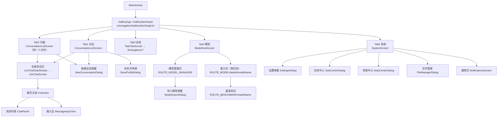
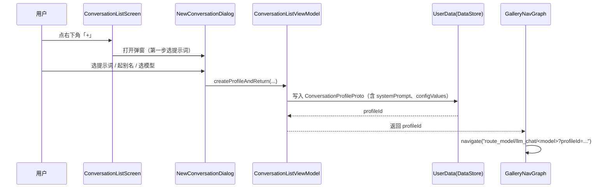
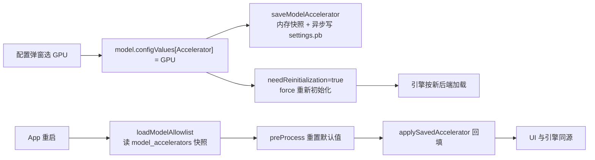

# 08 · 界面地图与数据流

> **这篇文档的定位**：项目里「界面怎么组织」「数据存哪、谁在用、什么时候用」的唯一总图。
> 新接手的人（包括 AI）只读这一篇，就能知道「改一个功能该动哪个文件」。
>
> 覆盖版本：`1.0.43 (versionCode 65)`。文中行号会随改动漂移，**文件名不会**，以文件名为准。
>
> 配套阅读：`01_架构说明.md`（分层与关键链路）、`05_数据与存储.md`（写盘缺陷细节）、
> `06_重构方案.md`（改造路线与进度）。

---

## 0. 30 秒速览

| 问题 | 答案 |
|---|---|
| 有几个界面？ | **1 个 Activity + 5 个顶层 Tab + 11 个二级页 + 若干弹窗/抽屉**，全部 Compose |
| 界面入口在哪？ | `MainActivity` → `GalleryApp`（`ui/navigation/`）→ `GalleryNavGraph` |
| 对话界面有几套？ | **只有一套**：`ChatView.kt`。普通对话、Agent、识图、语音全都复用它 |
| 数据存在哪？ | **7 个 DataStore 文件 + 1 个会话文件夹 + 若干缓存文件**（详见 §7） |
| 最容易踩的坑 | 「采样参数按会话存、运行后端按设备存」——两者混用就会出诡异 bug（§9） |

---

## 1. 界面层级总图



**关键事实**：底栏只有页面处于「顶层 Tab 路由」时才显示，判断逻辑是
`AppRoutes.isTopLevelRoute()`（`ui/navigation/BottomNavBar.kt`）。进入全屏会话后底栏自动隐藏。

---

## 2. 五个顶层 Tab

| # | Tab | 路由常量 | 页面文件 | 作用 |
|---|---|---|---|---|
| 1 | 对话 | `tab_chat` | `ui/conversation/ConversationListScreen.kt` | 会话列表（聊天/识图/语音三类记录），右下角「+」新建 |
| 2 | 功能 | `tab_agent` | 同上（**同一个文件**，靠 `types` 参数区分） | 只显示 Agent 记录（带 Skills/MCP 工具链） |
| 3 | 实验 | `tab_lab` | `ui/navigation/TaskTabScreen.kt` → `ui/llmsingleturn/*` | Prompt Lab 单轮实验；界面是输入框 + 多条并排结果 |
| 4 | 模型 | `tab_models` | `ui/modelmanager/ModelHubScreen.kt` | **4 项能力入口**（识图/语音/Tiny Garden/Mobile Actions）+ 模型下载与导入 |
| 5 | 系统 | `tab_system` | `ui/system/SystemScreen.kt` | 设置、通知、任务中心、文件管理、帮助 5 个入口 |

> 历史包袱：`ui/home/HomeScreen.kt`、`ui/home/SettingsDialog.kt` 等是早期「抽屉式首页」留下的文件，
> 现在部分仍在用（设置弹窗、语音设置、API 配置），部分已废弃。**不要看到 `home` 就以为是首页。**

---

## 3. 二级页面与路由表

| 路由常量 | 实际路径 | 目标文件 | 从哪进 |
|---|---|---|---|
| `ROUTE_MODEL` | `route_model/{taskId}/{modelName}?profileId=&type=&query=` | `ui/llmchat/LlmChatTaskModule.kt` → `LlmChatScreen.kt` | 模型 Tab 点能力、会话列表点记录 |
| `ROUTE_MODEL_LIST` | `model_list` | 模型 Tab 内的任务模型列表 | 模型 Tab |
| `ROUTE_MODEL_MANAGER` | `model_manager` | `ui/modelmanager/ModelManager.kt` + `ModelList.kt` | 模型 Tab、设置里的「管理模型」 |
| `ROUTE_BENCHMARK` | `benchmark/{modelName}` | `ui/benchmark/BenchmarkScreen.kt` | 模型列表的「跑分」按钮 |
| `ROUTE_NOTIFICATIONS` | `notifications` | `ui/notifications/NotificationsScreen.kt` | 系统 Tab |

> 这些常量都是 `private`，定义在 `ui/navigation/GalleryNavGraph.kt:122-126`。

其余二级界面都是**弹窗/抽屉形态**（不是独立路由）：

| 界面 | 文件 | 打开方式 |
|---|---|---|
| 新建会话（两步：选提示词 → 选模型） | `ui/conversation/NewConversationDialog.kt` | 会话列表右下角「+」 |
| 另存为特调 | `ui/conversation/SaveProfileDialog.kt` | 会话页顶栏菜单 |
| 历史会话侧边抽屉 | `ui/common/chat/ChatHistorySideSheet.kt` | 会话页顶栏「历史」 |
| 模型配置（采样参数 + 后端 + 系统提示词） | `ui/common/ConfigDialog.kt` | 会话页顶栏齿轮 |
| 会话顶栏（模型切换 / 推理来源切换） | `ui/common/ModelPageAppBar.kt` | 会话页固定顶部 |
| 设置 | `ui/home/SettingsDialog.kt` | 系统 Tab |
| 语音设置 / API 配置 / 本地服务 | `ui/home/VoiceSettings.kt`、`ApiProviderSettings.kt`、`LocalServerSection.kt` | 设置弹窗内 |
| 任务中心 | `ui/tasks/TaskCenter.kt` | 系统 Tab |
| 文件管理 | `ui/filemanager/FileManagerDialog.kt` | 系统 Tab |
| 帮助中心 | `ui/help/HelpCenterDialog.kt` | 系统 Tab |
| 技能管理 / MCP 管理 | `customtasks/agentchat/SkillManagerBottomSheet.kt`、`McpToolManagerBottomSheet.kt` | Agent 会话页 |

---

## 4. 复用关系（**最容易看错的地方**）

| 文件 | 被谁复用 | 说明 |
|---|---|---|
| `ChatView.kt`（1070 行） | **全项目唯一一份聊天主体** | 普通对话、Agent、识图、语音全部走它。改聊天行为只改这里 |
| `ChatPanel.kt`（999 行） | `ChatView` 内部 | 消息列表渲染循环 + 各种 `MessageBody*` 分派 |
| `MessageInputText.kt`（1234 行） | `ChatView` 内部 | 文字/图片/音频/拍照/录音输入，最复杂的一个文件 |
| `ConversationListScreen.kt` | **对话 Tab + 功能 Tab** | 靠 `types: Set<ConversationType>` 过滤；`GalleryNavGraph` 第 474 / 489 行两处调用 |
| `LlmChatScreen.kt` | 普通对话 + Agent | 负责顶栏 + 装配 `ChatView`；Agent 额外插入技能/工具入口 |
| `ModelPageAppBar.kt` | 所有会话页 | 顶栏含模型切换、推理来源（本地/云端）切换、配置入口 |
| `ChatViewModel.kt` | 所有对话页的基类 | **会话持久化逻辑都在这里**（保存/删除/读取） |
| `LlmChatViewModel.kt` | `ChatViewModel` 的子类 | 生成、绑定记录、提示词对齐 |
| `CustomTask` | `ModelManagerViewModel` 装配 | 一个「能力」= 一个 `CustomTask`，界面由 `CustomTask.MainScreen()` 提供 |

### 4.1 两个「Agent」不是一回事（这是用户反复搞混的根源）

| 名字 | 是什么 | 换它有什么效果 |
|---|---|---|
| **Agent 会话**（功能 Tab 的记录，`LLM_AGENT_CHAT`） | 真带工具链：能读 Skills、能调 MCP | 能力真的变了 |
| **AgentDefinition**（换角色皮肤） | **只是一段系统提示词** | 只改说话风格，能力一点没变 |

### 4.2 三处「提示词」不是一回事

| # | 名字 | 存在哪 | 作用范围 |
|---|---|---|---|
| 1 | 任务级全局提示词 | `UserData.secrets["system_prompt_$taskId"]` | 整个能力的默认角色 |
| 2 | **记录级提示词** | `ConversationProfile.systemPrompt` | 只属某一条会话记录，**优先级高于 1** |
| 3 | 云端提示词 | `ApiProviderConfig.systemPrompt` | 只对那套 API 生效 |

> 本地推理的坑：引擎在 `initializeModel` 时注入提示词，**发消息时不带提示词**。
> 所以记录级提示词必须走 `Model.pendingSystemInstruction`（未初始化）
> 或 `resetSession(clearHistory=false, systemInstruction=...)`（已保活）。
> 详见 `01_架构说明.md` 与提交 `44d8fcd`。

---

## 5. 关键交互流程

### 5.1 新建会话（点「+」）



**要点**：新建时写的是**记录**（profile），不是会话（session）。会话在第一次发消息落盘时才产生。

### 5.2 进入会话并绑定记录

1. `LlmChatTaskModule` 从路由取 `profileId` → `LlmChatViewModel.bindProfile(profile, task, model)`
2. `bindProfile` 把 `profile.systemPrompt` 设为界面提示词，并挂到 `model.pendingSystemInstruction`
3. 若模型**已在内存**（保活）→ 比较「引擎当前提示词 ≠ 记录提示词」，不一致才 `resetSession`
   （只清 KV cache，不重载权重，秒级）
4. `applyProfileConfigValues()` 把记录里的**采样参数**写进 `model.configValues`
   （注意：**运行后端不在此列**，见 §9.2）

### 5.3 发一条消息（两条完全不同的链路）

| | 本地端侧 | 云端 API |
|---|---|---|
| 判定 | `resolveActiveRemoteConfig() == null` | 有激活配置且 `use_remote_api` |
| 入口 | `runtimeExecutor.executeStream(request)` | `RemoteOpenAICompatProvider` |
| 提示词 | **不带**，用引擎初始化时注入的 | **每轮请求自带** |
| 加速器 | 初始化时决定，中途不可改 | 无关 |

### 5.4 切换模型

顶栏模型切换器（`ModelPageAppBar`）→ 改 `ModelManagerViewModel.uiState.selectedModel` →
若模型未加载则 `initializeModel`，已加载则复用实例。

### 5.5 切换运行后端（CPU/GPU/NPU）



**语义定论**：运行后端是**设备/模型级**设置，不是会话级。唯一真相源是
`Settings.model_accelerators`（modelName → CPU/GPU/NPU/TPU）。

---

## 6. 数据存储全景

### 6.1 七个 DataStore

> 注意：**不是 5 个**。前 5 个由 `di/AppModule.kt` 创建，后 2 个由各自模块自己创建，
> 所以只翻 `AppModule.kt` 会漏掉它们（2026-11-02 才补齐这两处的损坏兜底）。

| 文件 | 创建处 | proto 消息 | 存什么 | 主要读写方 |
|---|---|---|---|---|
| `settings.pb` | `di/AppModule.kt` | `Settings`（`settings.proto`） | 主题、是否同意条款、导入模型列表、文本输入历史、**每模型运行后端**、全局默认模型、API 配置、语音设置、定时任务、本地服务配置 | `DataStoreRepository`（总入口）、`ApiProviderRepository`、`VoiceSettingsRepository`、`TimedTaskRepository`、`LocalServerRepository` |
| `user_data.pb` | `di/AppModule.kt` | `UserData`（`settings.proto:213`） | `secrets`（含各类提示词与迁移标记）、**会话特调记录** `conversation_profiles`、MCP 鉴权、自定义模板选项、~~`chat_sessions`~~（已降级为回退快照） | `DataStoreRepository`、`ConversationProfileRepository`、`SystemPromptRepository`、`SessionMigrator` |
| `skills.pb` | `di/AppModule.kt` | `Skills`（`skill.proto`） | 技能定义与启用状态 | `SkillManager`、`DataStoreRepository` |
| `benchmark_results.pb` | `di/AppModule.kt` | `BenchmarkResults`（`benchmark.proto`） | 跑分结果 | `BenchmarkViewModel` / `DataStoreRepository` |
| `cutouts.pb` | `di/AppModule.kt` | `CutoutCollection`（`settings.proto:273`） | 截图涂鸦（基本闲置） | `DataStoreRepository` |
| `mcp_servers.pb` | `customtasks/agentchat/AgentChatTaskModule.kt` | `McpServers`（`mcp.proto`） | MCP 服务器清单 | `McpServersProvider` |
| `scheduled_notifications.pb` | `notifications/NotificationScheduleManager.kt` | `ScheduledNotifications`（`scheduled_notification.proto`） | 定时通知计划 | `NotificationScheduleManager` |

> **全部 7 个都挂了损坏兜底**（`data/DataStoreCorruptionHandlers.kt`）：
> 解析失败时备份成 `xxx.pb.corrupt-<时间戳>` 再回落默认值，不会无限崩溃。
> `scheduled_notifications.pb` 落在 `filesDir` 而非 `files/datastore/`，所以它用的是
> 按 `File` 定位的重载，而不是按 `Context` 定位的那个。

### 6.2 会话文件（P1b 之后的主路径）

```
filesDir/
├── datastore/
│   ├── settings.pb           ← DataStore 实际落盘位置
│   ├── user_data.pb
│   ├── skills.pb
│   ├── benchmark_results.pb
│   ├── cutouts.pb
│   └── mcp_servers.pb        ← MCP 服务器清单
├── scheduled_notifications.pb ← 注意：不在 datastore/ 下
├── sessions/                 ← 【新】一条会话一个文件
│   ├── index.tsv             ← 轻量索引（id/标题/时间/模型/预览）
│   └── s_<安全名>-<hash>.pb  ← 单条会话正文（ChatSessionProto）
└── migration_backup/         ← 迁移前的 user_data.pb 整份备份（留最近 2 份）
```

| 类 | 文件 | 作用 |
|---|---|---|
| `SessionFileStore` | `data/conversation/SessionFileStore.kt` | 单会话单文件读写；`.tmp` + rename 原子替换；索引更新用 `Mutex` 串行；内存索引 `StateFlow` |
| `SessionMigrator` | `data/conversation/SessionMigrator.kt` | 旧字段 → 文件的一次性搬运；备份、增量、孤儿清理、完成标记 |

**为什么这么改**：原来所有会话都在 `UserData.chat_sessions` 一个 repeated 字段里，
每次保存要 `clearChatSessions()` + `addAllChatSessions(全部)`，写盘成本 O(全部会话 × 全部消息)。
现在保存一条 = 写一个文件；打开列表 = 只读 `index.tsv`，**一个会话正文都不解析**。

### 6.3 其他文件（容易被忽略）

| 位置 | 内容 | 谁写 |
|---|---|---|
| `cacheDir/img_*`、`audio_*` | 会话里的图片/音频副本 | `ChatViewModel.saveSession`、录音面板 |
| `externalFilesDir/imports/` | 用户导入的 `.litertlm` 模型 | `ModelManagerViewModel` |
| `externalFilesDir/<模型名>/<版本>/` | 下载的模型文件 | `DownloadRepository` |
| 用户选定的导出路径 | 会话导出的 Markdown | `ChatMarkdownExporter` + SAF |

### 6.4 proto 结构要点

| 文件 | 关键消息 | 备注 |
|---|---|---|
| `settings.proto` | `Settings`、`UserData`、`ImportedModel`、`ApiProviderConfig`、`TimedTask`、`LocalServerConfig`、`McpAuth`、`Cutout*` | **一个文件装了 5 个域的配置**，字段号已被多处引用，**不要改已有字段号** |
| `chat_history.proto` | `ChatSessionProto`、`ChatMessageProto` | 单条会话正文；`chat_sessions` 与 `sessions/*.pb` 共用这个结构 |
| `conversation_profile.proto` | `ConversationProfileProto` | 特调记录（会话列表里的一条） |
| `skill.proto` | `Skills`、`Skill` | 技能 |
| `benchmark.proto` | `BenchmarkResults` | 跑分 |
| `mcp.proto` | MCP 工具定义 | Agent 工具链 |
| `hf_model.proto` | HuggingFace 模型元数据 | 下载用 |
| `scheduled_notification.proto` | 通知计划 | 定时任务联动 |

---

## 7. 数据流：谁在什么时候读写

### 7.1 App 启动

| 顺序 | 动作 | 位置 |
|---|---|---|
| 1 | 初始化 5 个 DataStore | `di/AppModule.kt` |
| 2 | 后台跑会话迁移切换 `cutoverIfNeeded()`（只跑一次，失败可续跑） | `GalleryApplication` |
| 3 | 启动本地 API Server 自动启停监听 | `LocalServerService.initialize` |
| 4 | `loadModelAllowlist()`：读 allowlist → 建 `Model` → 读 `model_accelerators` 快照 → `processTasks()`（`preProcess` + 回填后端） | `ModelManagerViewModel` |

### 7.2 打开会话列表

```
SessionFileStore.indexState (StateFlow)
   → ChatViewModel.historySessions（转成只带元数据的 lite proto）
      → ConversationListScreen 渲染
```
**不再反序列化任何会话正文**。列表项标题、预览、时间全部来自 `index.tsv`。

### 7.3 点开一条会话

1. `readSessionContent(sessionId)` → 读**那一个** `.pb` 文件（失败则回退旧字段，再失败提示「读取失败」）
2. `deserializeProtoMessages()` → `ChatMessage*` 列表
3. `clearAllMessages` + 逐条 `addMessage`
4. `resetSession(clearHistory=false, initialMessages=...)` 让引擎上下文对齐

### 7.4 生成过程中

| 时机 | 写什么 | 位置 |
|---|---|---|
| 每 3 秒（正文变长才写） | 该会话文件 + 记录摘要 | `ChatView.kt` 节流 effect |
| 生成结束 | 正式保存一次 | `ChatView.kt` `LaunchedEffect(uiProgress)` |
| 改采样参数 | 写回记录（**不含运行后端**） | `persistConfigValuesToProfile` |

### 7.5 删除

| 操作 | 连带清理 |
|---|---|
| 删一条会话 | 会话文件 + 索引 + profile 里的 sessionId |
| 删一条特调记录 | 其名下**全部**会话文件 + 索引 + profile（`ConversationProfileRepository` 注入了 `SessionFileStore`） |
| 清空全部 | 所有会话文件 + 索引 + 缓存图片/音频 |

---

## 8. 分层与文件清单

```
app/src/main/java/com/encourage/app/
├── MainActivity.kt                 入口 Activity
├── GalleryApplication.kt           启动初始化（迁移、本地服务）
├── CrashDisplayActivity.kt         崩溃兜底页（"黑屏 + 白英文"就是它）
├── data/                           数据层（见下）
├── agent/                          本地推理执行器（AgentRuntimeExecutor / DefaultAgentRuntimeExecutor）
├── runtime/                        LiteRT-LM 模型加载与运行辅助（LlmModelHelper）
├── skills/                         Skills 加载与执行
├── ui/                             界面层
├── customtasks/                    各种「能力」的实现（每个能力一套 Screen + Task + VM）
├── di/                             Hilt 模块（AppModule 里注册 5 个 DataStore）
└── notifications/、speech/ 等      横切能力
```

### 8.1 `data/` 关键文件

| 文件 | 作用 |
|---|---|
| `DataStoreRepository.kt` | **设置类数据的唯一入口**（含 84 处 `runBlocking`，见 §9.5） |
| `Model.kt` | 模型定义 + `configValues` + `preProcess()`（每次装配列表都会重置配置） |
| `Config.kt` / `ConfigKeys` | 配置项定义：`ACCELERATOR`、`TOPK`、`TEMPERATURE`…（**`id` 与 `label` 两套键**） |
| `Tasks.kt` / `Categories.kt` | 任务（能力）定义与顺序 `PREDEFINED_LLM_TASK_ORDER` |
| `ModelAllowlist.kt` | 从 allowlist 构建模型（决定每个模型支持哪些后端） |
| `SystemPromptRepository.kt` | 任务级全局提示词（`secrets["system_prompt_$taskId"]`） |
| `conversation/ConversationProfile.kt` + `Repository` | 特调记录（会话列表的一条） |
| `conversation/SessionFileStore.kt` | 会话文件存储（P1b） |
| `conversation/SessionMigrator.kt` | 旧数据迁移与切换 |
| `api/ApiProviderRepository.kt` | 云端 API 配置（`settings.pb`） |
| `speech/VoiceSettingsRepository.kt` | 语音设置（`settings.pb`） |
| `tasks/TimedTaskRepository.kt` | 定时任务（`settings.pb`） |
| `server/LocalServerRepository.kt` | 本地 HTTP 服务配置（`settings.pb`） |
| `DataStoreCorruptionHandlers.kt` | 5 个 DataStore 的损坏备份兜底 |

### 8.2 `customtasks/` 各能力

| 目录 | 能力 | 入口 |
|---|---|---|
| `agentchat/` | Agent（Skills + MCP） | 功能 Tab 的记录 |
| `tinygarden/` | Tiny Garden（WebView 小游戏 + LLM 生成素材） | 模型 Tab |
| `mobileactions/` | 手机操作（无障碍） | 模型 Tab |
| `examplecustomtask/` | 示例模板 | 无（开发参考） |

---

## 9. 数据陷阱清单（踩过的坑，别再踩）

### 9.1 采样参数：键是 `label`，不是 `id`

- 运行时读取：`Model.getTypedConfigValue()` 用 `ConfigKey.label`（`TopK`、`Temperature`）
- 记录存储：`ConversationProfile.configValues` 用 `ConfigKey.id`（`topk`、`temperature`）
- **直接把记录的 map 塞进 `model.configValues` 会静默失效**（读不到、也不报错）
- 唯一映射表：`LlmChatViewModel.PROFILE_CONFIG_KEYS`

### 9.2 运行后端是**设备级**，不能当采样参数

`ACCELERATOR` / `VISION_ACCELERATOR` **必须**留在 `PROFILE_CONFIG_KEYS` 之外。
放进去会导致三个症状同时出现（1.0.40 及之前就是这样）：

1. 换会话后端乱跳（用记录里的值覆盖模型设置）
2. 重启后变回默认（默认是 `accelerators[0]`，常见是 CPU）
3. **界面显示 NPU、实际跑 CPU**（已初始化时只改显示不重建引擎）

### 9.3 `preProcess()` 会重置配置

`Model.preProcess()` 在**每次装配模型列表**时都会跑（`processTasks()`）。
任何「用户选择」如果只存在 `configValues` 里，都会被冲掉。已有对策：保留 `accelerator`
+ `applySavedAccelerator()` 回填。**新增用户级配置时务必照这个模式做。**

### 9.4 「读快照 → 改 → 整体覆盖」会丢更新

三处历史缺陷已改为原子方法（`removeImportedModel` / `upsertImportedModel` / `replaceSkill`）。
新写代码不要再用 `readXxx()` + `saveXxx(整份)`。

### 9.5 `runBlocking` 到处都是

`DataStoreRepository` 里 84 处。**界面线程上的调用已全部挪到 IO**（1.0.38），
但接口本身仍是同步的。新增代码：**不要在 Compose 组合期或主线程直接调仓库**。

### 9.6 DataStore 损坏 = 无限崩溃

已加兜底。若线上仍见「黑屏 + 白英文」，去 `CrashDisplayActivity` 与
`files/datastore/*.corrupt-*` 找证据。

---

## 10. 排障速查表

| 现象 | 先看哪 |
|---|---|
| 提示词选了什么都是同一个角色 | `LlmChatViewModel.bindProfile` / `Model.appliedSystemInstruction` / `initializeModel` |
| 换了后端但速度没变 / 显示与实际不符 | `ModelManagerViewModel.applySavedAccelerator`、`Model.preProcess`、`PROFILE_CONFIG_KEYS` |
| 会话越用越卡 | `SessionFileStore` 是否在走文件路径（`ChatViewModel.saveSession`） |
| 老会话打开空白 | `sessions/` 文件是否存在、`migration_backup/` 是否有备份 |
| 模型列表里模型消失 | `DataStoreRepository.readImportedModels` 与 `removeImportedModel` |
| 技能勾选自己变回去 | `SkillManager.updateSkillInDataStore`（应为原子里写） |
| 开屏闪退 | `files/datastore/*.corrupt-*`、`CrashDisplayActivity` |
| 对话页输入框永久禁用 | `isResettingSession` 是否卡在 true（看 `resetSession` 的 try/finally） |

---

## 11. 维护约定

1. **改界面必须同步改这一篇**：新增页面 → 补 §3 路由表；新增数据 → 补 §6。
2. **新增「用户级设置」时**：先判断它是**设备级**还是**记录级**，再决定放 `Settings` 还是
   `ConversationProfile`。判断错就是 §9.2 那类 bug。
3. **改 proto 字段号 = 灾难**：`settings.proto` 里 `Settings` 与 `UserData` 被 5 个仓库共用，
   两个 store 都引用 `conversation_profile.proto`。只加字段，不改号、不复用号。
4. 文档里的行号会漂，**用文件名 + 函数名定位**，不要背行号。
