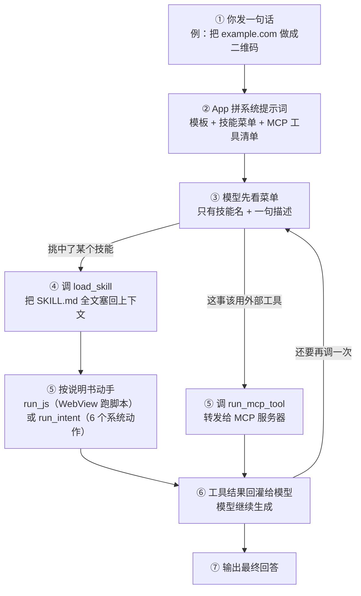

# HUMAN · 技能、MCP、Agent 到底是什么（人话手册）

> **这份文档是写给人看的，不是给 AI 看的。**
> 目标是：你看完能自己判断"为什么这次它没调技能"，而不是只知道"它有时候不好用"。
>
> - 对应代码基线：`versionCode 64 / 1.0.42`（提交 `6fe2c34`）
> - 事实类文档在 `07_Agent与Skill_实现事实.md`；这份是**讲解版**，可以带比喻。
> - 本文所有"文件:行号"都可在仓库里直接搜到，不是凭印象写的。

---

## 0. 先给结论（三句话）

1. **这个项目里，"技能"不是工具**。技能是一份**说明书**（`SKILL.md`）+ 可选的脚本；真正动手的是 4 个固定工具。
2. **"调不动"的头号原因是个真 bug**：只要你做过「选 Agent / 改系统提示词 / 打开带提示词的特调记录」其中任意一件事，系统提示词里的**技能菜单会被整段替换掉**，模型从此不知道有哪些技能。
3. **2B~4B + 16K 确实很紧**，但那是"成功率低、容易忘"，不是"完全不能调"。完全不能调，基本都落在第 2 条。

---

## 1. 一张图看懂：一句话进来，经过什么



文字版（方便贴到别处）：

```
你说话
  → App 拼提示词（技能菜单 + 工具清单）
  → 模型看菜单，决定"用哪个技能 / 用哪个工具 / 直接回答"
  → 用技能：load_skill 取说明书 → 按说明书调 run_js 或 run_intent
  → 用工具：run_mcp_tool 转发给 MCP 服务器
  → 结果回灌 → 模型继续 → 最终回答
```

**关键点在第 ② 步**：模型能不能"看见"技能，完全取决于这一步有没有把技能清单写进提示词。
菜单没了，后面全断。

---

## 2. 三个东西，一句话分清

先给标准层，再给白话层。两层都要有，缺一层你以后看文档会卡。

### 2.1 Skill（技能）

- **标准层**：一个目录，含 `SKILL.md`（front-matter：`name` + `description`；正文：操作说明）和可选的 `scripts/`。
  它**不注册进 `ToolsProvider`**，不会被当成函数给模型。模型要先调 `load_skill` 把正文读进上下文，再按说明去调别的工具。
  代码：`skills/SkillManager.kt`、`tools/LoadSkillTool.kt`、`skills/SkillExtensions.kt`。
- **白话层**：技能 = **菜谱**。菜谱本身不能做菜，它只是告诉你"先热锅、再放油、用哪口锅"。
  锅（工具）一直是那 4 口，菜谱决定怎么用。

### 2.2 MCP（Model Context Protocol）

- **标准层**：一套开放协议，App 作为客户端连到 MCP 服务器，拉取对方暴露的工具列表（名字 / 描述 / JSON Schema），
  运行时用 `run_mcp_tool(toolName, input)` 转发调用。代码：`mcp/McpServersProvider.kt`、`tools/RunMcpTool.kt`。
- **白话层**：MCP = **插座标准**。插座本身不发电，但它让任何电器（外部服务）都能插上来用。
  你接一个搜索服务、一个数据库服务，它们就变成模型可以"伸手去按"的按钮。

### 2.3 Agent（智能体）

- **标准层**：在这个项目里，Agent **只是一段系统提示词 + 元数据**。
  `assets/agents/*.json` 的字段只有 `id / name / description / author / version / systemPrompt`。
  **没有 `skills:[…]`、没有 `tools:[…]`、没有 `modelId`。** 选一个 Agent，等于把它的 `systemPrompt` 覆盖到会话上。
- **白话层**：Agent = **戏服**。换上"翻译"的戏服，说话风格变了；但会的手艺（工具）一点没变。
  它不会因为叫"程序员"就自动会写代码工具。

### 2.4 三者对照表（背下这张就够）

| | 本质是什么 | 谁真正执行 | 模型怎么知道它存在 | 存在哪 |
|---|---|---|---|---|
| **Skill** | 说明书 + JS 脚本 | App（WebView 跑 JS / 调 Intent） | 系统提示词里的「技能菜单」 | `assets/skills/`、`filesDir/skills/` |
| **MCP** | 外部工具服务器 | 外部进程或网络服务 | 系统提示词里的「工具清单」 | `mcp_servers.pb` + 网络连接 |
| **Agent** | 一段人格提示词 | **不执行任何东西** | 直接替换整个系统提示词 | `assets/agents/*.json` |

一句话记法：

> **Skill 管"怎么做"，MCP 管"能做哪些外部动作"，Agent 只管"用什么口气说"。**

---

## 3. 完整调用链（跟着代码走一遍）

### 第 ① 步：你按下发送

消息进入 `LlmChatViewModel.generateResponse()`，转给 `DefaultAgentRuntimeExecutor.executeStream()`。
真正的推理只有一次调用：`runtimeHelper.runInference(...)`（`agent/DefaultAgentRuntimeExecutor.kt:145`）。

### 第 ② 步：拼系统提示词（**整条链最脆弱的地方**）

`AgentChatTaskModule.kt:157-181`：

```
systemPrompt 模板（含 ___SKILLS___ 和 ___TOOLS___ 两个占位符）
   ├─ ___SKILLS___ ← formatSelectedSkills(被勾选的技能)
   └─ ___TOOLS___  ← 已启用 MCP 服务器里的工具清单
```

`formatSelectedSkills()`（`skills/SkillExtensions.kt:29-35`）给每个技能只输出两行：

```
- Skill name: "qr-code"
- Description: 为给定URL生成二维码。
```

**只给名字和描述，不给正文**——这叫"渐进式披露"，是为了省上下文。
正文要等模型主动调 `load_skill` 才进来。

> ⚠️ 替换逻辑本身极其朴素：`PromptExpander.formatSystemInstructions()` 就是字符串 `replace`。
> **模板里没有占位符，它就什么都不做，也不报错**（`agent/PromptExpander.kt:29-35`）。
> 这就是后面所有"技能消失"事故的根源。

### 第 ③ 步：4 个工具注册进引擎

`AgentTools.kt:80-82` 固定返回 4 个，不增不减：

| 模型看到的工具名 | Kotlin 方法 | 干什么 | 备注 |
|---|---|---|---|
| `load_skill` | `loadSkill` | 取技能说明书全文 | 名字必须完全对得上（见下） |
| `run_mcp_tool` | `runMcpTool` | 转发给 MCP 服务器 | 有权限确认 |
| `run_js` | `runJs` | 在聊天 WebView 里跑技能脚本 | 60 秒超时 |
| `run_intent` | `runIntent` | 6 个系统动作白名单 | 见 §5.3 |

⚠️ **命名规则是个坑**：LiteRT-LM 0.16.0 内部会把 Kotlin 方法名做 `camelToSnakeCase`
（反编译 `com.google.ai.edge.litertlm.ReflectionTool` 可见），所以模型看到的是 `load_skill`，不是 `loadSkill`。

### 第 ④ 步：模型调 `load_skill`

`LoadSkillTool.kt:34-67`：按名字找到技能，返回 `---\nname: …\ndescription: …\n---\n\n<正文>`。
找不到就返回字符串 `"Skill not found"`——**注意，这是一句"工具结果"，不是报错**，模型可能拿着它继续瞎猜。

### 第 ⑤ 步：按说明书动手

- `run_js`：把 `scripts/xxx` 加载到一个隐藏 WebView（300dp），执行
  `window.ai_edge_gallery_get_result(data, secret)`，再通过 JS 桥 `AiEdgeGallery.onResultReady` 把字符串回传。
  → 完整浏览器能力（网络、Canvas、crypto），但**碰不到 Android 原生 API**。
- `run_intent`：只认 6 个动作，超出白名单直接失败（`intents/IntentHandler.kt:72-78`）。
- `run_mcp_tool`：`client.callTool(...)`（`tools/RunMcpTool.kt:106`），结果转成文本回灌。

### 第 ⑥ 步：结果回灌，继续生成

**关键事实：工具调用循环在引擎内部，Kotlin 侧没有轮次上限。**
`DefaultAgentRuntimeExecutor` 只发起一次 `runInference`，剩下由 LiteRT-LM 自己 ReAct。
唯一保护是 JS 的 60 秒超时（`AgentChatScreen.kt:359`）和等 JS 函数就绪的 10 秒（`:428`）。

→ 所以小模型如果陷进"调工具 → 不满意 → 再调"的循环，会一直转到 token 用完。

---

## 4. 为什么你会觉得"调不动"——四个真原因

### 原因 1（决定性 bug）：技能菜单会被整段抹掉

**现象**：模型像不知道有技能这回事，要么直接瞎答，要么编一个技能名去 `load_skill`，然后拿到 `Skill not found`。

**根因**：占位符替换只发生在两个地方：

- 首次初始化：`AgentChatTaskModule.kt:172-181`
- 页面上的"重置会话"：`AgentChatScreen.kt:817-826`

但有 **三条常用路径绕过了它们**，直接拿"原始提示词"去重置会话：

| 触发动作 | 代码路径 | 结果 |
|---|---|---|
| 在 Agent 页选一个 Agent | `AgentChatScreen.kt:727-732` → `applySystemPromptChange` | 系统提示词 = agent 的人设文本，**没有占位符** |
| 手动编辑系统提示词 | `ModelPageAppBar.kt:280` → `applySystemPromptChange`（`LlmChatViewModel.kt:496-503`） | 同上 |
| 打开一条写过提示词的「特调记录」 | `LlmChatViewModel.bindProfile`（`:275-308`）→ `resolveActiveRemoteConfig` 分支 → `resetSession(原文)`；模型没初始化时走 `ModelManagerViewModel.kt:706` 的 `pendingSystemInstruction` | 同上 |

三条路径的终点都是 `LlmChatViewModel.resetSession(systemInstruction = 原文)`，
而 `resetSession` **不会**做占位符替换（它只把字符串塞给执行器）。

于是系统提示词里 **一个技能名都没有**，`___SKILLS___` 这七个下划线也不会出现——模型看到的就是那个 Agent 的人设。
**技能菜单彻底消失，而且界面上的技能数量徽标还照常显示，你根本看不出来。**

> 顺带说一句：编辑器里的「恢复默认」按钮能把模板文本填回来（`ConfigDialog.kt:252-257`），
> 但保存后仍然走上面那条"原文"路径，模型看到的是字面量 `___SKILLS___`。
> 要真正恢复，得在恢复默认之后再点一次页面上的"重置会话"。

**为什么这解释了你说的"非常卡顿 / 没法调用"**：
一旦菜单空了，模型只能靠工具的函数签名瞎猜。它会反复尝试 `load_skill`、反复失败，
每一步都是一次完整推理——表现出来就是"卡很久，然后什么都没干"。

### 原因 2（硬 bug）：提示词里 MCP 工具名写错了

`AgentChatTaskModule.kt:80` 和 `:93` 写的是 `runMcpTool`，
但模型实际看到的工具名是 `run_mcp_tool`（见 §3 第 ③ 步）。

模型很听话地照提示词去调 `runMcpTool` → 引擎里没有这个函数 → 调用失败或干脆不发起调用。
**这条单独就能让 MCP 完全不可用。**

### 原因 3（设计问题）：没有 MCP 时，提示词禁止它正常回答

`getEffectiveBaseSystemPrompt(currentPrompt, hasMcpTools)`（`AgentChatTaskModule.kt:277-283`）：
没有启用 MCP 工具时，用的是 `DEFAULT_SYSTEM_PROMPT_SKILLS_ONLY`，它的第 4 步写着：

> If no relevant skill is found, output "No relevant skills found" and stop.

也就是说：**问一句"你好"，它也可能只回 "No relevant skills found"。**
这不是模型不会聊天，是提示词明确让它"找不到技能就停"。
一个通用助手页面上挂这种提示词，注定难用。

### 原因 4（预算不够）：16K 真的装不下这套东西

按当前默认值算一笔账（`Consts.kt:42` 的 `DEFAULT_MAX_TOKEN = 16384`，就是你说的 16K）：

| 占上下文的东西 | 估算 token | 依据 |
|---|---|---|
| 系统提示词（完整版 2096 字符，英文） | ~500 | `AgentChatTaskModule.kt:58-98` |
| 技能菜单（12 条，794 字符，中文） | ~600–900 | `SkillExtensions.kt:29-35` + `assets/skills/` |
| 4 个工具的函数声明 | ~300 | LiteRT-LM 生成的 JSON Schema |
| 一个技能全文（`learn-something-new` 7651 字节） | ~2500–3500 | `assets/skills/learn-something-new/SKILL.md` |
| 你的历史对话 | 剩下的 | — |

**两三轮对话 + 一次 `load_skill`，16K 就见底了。**
超了之后引擎会截断，而最先被丢掉的往往是**系统提示词和工具定义**——
于是出现那种"上一句还能调，下一句突然不调了"的诡异现象。

再加两个雪上加霜的因素：

- **强制 TopK=1 贪婪解码**（`AgentChatSamplingParamsManager.kt:116-118`）：Agent 场景固定用它保证格式稳定，
  代价是"一条路走到黑"，第一步选错就不会回头。
- **约束解码**（`enableConversationConstrainedDecoding = true`）：保证工具调用格式合法，但会拖慢出字速度，
  小模型上体感明显。

最后一层：**提示词是英文，技能描述是中文**。2B~4B 模型跨语言做"意图 → 技能"的匹配，
本来就比同语言弱一截，这是能力问题，不是 bug。

---

## 5. 那怎么用才靠谱（在 bug 修好之前）

### 5.1 三条立刻能用的

1. **别在 Agent 页做这三件事**：选 Agent、改系统提示词、打开带提示词的特调记录。
   想换风格，去「对话」页用特调记录。
2. **只勾 1~2 个技能**。菜单越短，小模型选得越准，也越省上下文。
3. **用命令式触发词，别让它猜**。
   - 好："用二维码技能，把 `example.com` 做成二维码"
   - 差："帮我搞个二维码"

### 5.2 判断"是不是菜单没了"的最快办法

看它是不是这样：

- 完全不理技能，直接自己编答案 → 大概率菜单没了（原因 1）
- 反复说 "No relevant skills found" → 原因 3，或者技能根本没勾
- 调了工具但名字对不上 / 报 not found → 原因 2（MCP）或技能没勾（Skill）
- 前两轮正常，后面突然不调 → 原因 4，上下文爆了

### 5.3 `run_intent` 能干的 6 件事（别指望更多）

`send_email`、`send_sms`、`create_calendar_event`、`read_calendar_events`（需日历权限）、
`get_current_date_and_time`、`schedule_notification`。

读剪贴板、通讯录、定位、传感器、直接读 App 数据库——**代码里没有对应工具**，说也没用。

### 5.4 技能文件放哪、长什么样

```
assets/skills/<name>/          ← 内置（只读）
filesDir/skills/<name>/        ← 你自建 / SAF 导入
  SKILL.md                     ← 必需
  scripts/index.html           ← 可选：WebView 界面
  scripts/index.js             ← 可选：真正干活的代码
  assets/*                     ← 可选
```

`SKILL.md` 最小可用模板：

```markdown
---
name: my-skill
description: 一句话说清"什么时候该用它"（这句话是模型唯一的判断依据）
---

# 使用说明

你必须调用 `run_js`，传入以下精确参数：
- skillName: my-skill
- scriptName: index.html
- data: JSON 字符串，字段 xxx
```

写技能的两个要点：

1. `description` 要写"**用户会怎么问**"，不要写"这个技能实现了什么"。
2. 正文里**明确写出工具名和参数名**。小模型不会推理，它只会照抄。

---

## 6. 现象 → 原因 → 怎么办（排障表）

| 你看到的 | 最可能的原因 | 现在能怎么办 |
|---|---|---|
| 只回 "No relevant skills found" | 原因 3（提示词强制停止） | 明确说"用 XX 技能" |
| 完全不调工具，直接编答案 | 原因 1（菜单被抹） | 新开会话，别选 Agent；或"重置会话"一次 |
| 技能徽标显示 5 个，但它一个都不用 | 原因 1 | 同上 |
| 调 `load_skill` 却返回 Skill not found | 技能没勾 / 名字猜错 | 去技能管理勾上；说话时带上技能名 |
| MCP 工具调了没反应 | 原因 2（名字写错） | 目前无解，等修 |
| 前两轮能调，后面突然不调 | 原因 4（上下文爆了） | 新开会话，少勾技能 |
| 卡很久不出字 | 约束解码 + TopK=1；或 JS 60 秒超时 | 等，或点停止 |
| 输出一堆 `___SKILLS___` 之类的怪字 | 恢复了默认提示词但没重置会话 | 点一次"重置会话" |

---

## 7. 想自己验证？三条命令

```bash
# 看技能有没有被加载、有没有被调用
adb logcat | grep -E "AGLoadSkillTool|AGRunMcpTool|AGRunJsTool"

# 看提示词拼装与初始化
adb logcat | grep -E "AGAgentChatTask|AGDefaultAgentRuntimeExecutor"

# 看当前模型到底用了哪个技能（技能加载会打完整正文）
adb logcat -s AGLoadSkillTool
```

判断标准：

- 日志里**完全没有** `AGLoadSkillTool` → 模型一次都没调 `load_skill` → 先怀疑原因 1/3。
- 有 `load skill. Skill content:` 但内容是 `Skill not found` → 名字对不上，怀疑技能没勾。
- 有 `Run MCP tool:` 但接下来是 `tool_not_found` → 原因 2。

---

## 8. 名词表（双轨）

| 词 | 标准解释 | 一句白话 |
|---|---|---|
| Skill | `SKILL.md` + scripts 的目录，按需加载的说明书 | 菜谱 |
| `load_skill` | 把某个技能的正文读进上下文的工具 | 翻开菜谱 |
| `run_js` | 在 WebView 里执行技能脚本的工具 | 按菜谱开火 |
| `run_intent` | 触发 6 个白名单系统动作的工具 | 按开关（只有 6 个） |
| MCP | 连接外部工具服务器的标准协议 | 插座标准 |
| `run_mcp_tool` | 把调用转发给 MCP 服务器的工具 | 把电器插上去 |
| Agent | 只有 `systemPrompt` 的人格配置 | 戏服 |
| 渐进式披露 | 先只给名字和描述，正文按需加载 | 先看目录，再翻页 |
| 约束解码 | 强制输出符合 JSON/工具调用语法 | 只准说"人话格式" |
| TopK=1 | 每步只选概率最高的词（贪婪解码） | 一条路走到黑 |

---

## 9. 一句话收尾

这套设计的骨架是对的（渐进式披露 + 原生 function calling + 外部工具标准化），
**坏在"提示词拼装"这一层没有收口**：只要有别的入口能直接改系统提示词，技能菜单就会消失。

所以修的时候不用重写，只要做一件事：
**把"技能菜单 + 工具清单"的注入挪到唯一的出口（`resetSession` 之前统一展开），任何入口都绕不过去。**
具体修法见 `07_Agent与Skill_实现事实.md` §7 的 B1。
